# Лабораторная работа №5

## Организация репозитория в системе управления версиями Git

**Дисциплина:** Информатика  
**Студент:** Кислов К. Е.  
**Группа:** 4616  
**Логин GitHub:** knaT43-T  
**Дата выполнения:** 01.11.2026  
**Индивидуальный проект:** GreenGlow — магазин натуральной косметики

---

## 1. Цель работы

Цель работы — приобрести практические навыки организации проекта в системе управления версиями Git: создать публичный удалённый репозиторий, освоить работу с ветвями, выполнить слияние ветви с основной ветвью, создать форк внешнего репозитория и опубликовать сайт с помощью GitHub Pages.

## 2. Задачи работы

1. Восстановить сайт GreenGlow, подготовленный в лабораторной работе №4, и разместить его в рабочей папке.
2. Создать публичный репозиторий на GitHub и связать его с локальной рабочей папкой.
3. Создать не менее трёх ветвей проекта и показать их назначение.
4. Создать форк внешнего открытого репозитория.
5. С помощью агента добавить на сайт не менее трёх локальных изображений из рабочей папки.
6. Выполнить слияние ветви с изображениями с ветвью `main`.
7. Опубликовать сайт через GitHub Pages и проверить его работоспособность.
8. Подготовить текст отчёта, скриншоты и итоговую проверку выполнения требований.

## 3. Используемое программное обеспечение

| Инструмент | Версия / назначение |
|---|---|
| Windows | 11, рабочая станция |
| Git | 2.55.0.windows.5 |
| GitHub CLI | 2.102.0 |
| GitHub | публичный репозиторий, форк, Pull Request, GitHub Pages |
| Python | 3.10.6 |
| Pillow | 12.1.1, генерация локальных изображений |
| Playwright-core | съёмка скриншотов в headless-режиме |
| Microsoft Edge | браузер для проверки и скриншотов |
| Visual Studio Code | редактирование файлов проекта |

## 4. Индивидуальный проект

Индивидуальный проект — одностраничный лендинг магазина натуральной косметики **GreenGlow**. Сайт восстановлен по материалам лабораторной работы №4: в исходной рабочей папке находился только PDF-отчёт, поэтому HTML-страница была создана заново по описанию проекта.

### 4.1. Структура сайта

Лендинг состоит из восьми смысловых блоков:

1. шапка с логотипом, навигацией, корзиной и CSS-бургер-меню;
2. hero-блок с заголовком «Красота, созданная природой» и карточкой товара;
3. блок «О бренде» с философией и статистикой;
4. блок преимуществ с тремя карточками;
5. каталог из шести товаров;
6. блок отзывов;
7. блок контактов и доставки;
8. подвал сайта.

### 4.2. Ограничения и стиль

Сайт выполнен в одном файле `index.html` со встроенными CSS-стилями. Используются:

- палитра `#F9F6F0`, `#8A9A86`, `#2C3E2D`, `#FFFFFF`;
- системные шрифты, без внешних шрифтов и библиотек;
- CSS-адаптивность: 3 колонки на десктопе, 2 на планшете, 1 на мобильном;
- CSS-бургер-меню без JavaScript;
- три локальных изображения товаров в папке `assets/img`;
- отсутствие внешних ссылок на изображения и шрифты.

Проверка HTML показала: 6 секций, шапка и подвал (итого 8 блоков), 3 тега ``, 0 тегов `<script>`, 0 внешних ссылок, 5 медиазапросов.

## 5. Ход выполнения работы

### 5.1. Восстановление сайта и первый коммит

В рабочей папке `C:\Users\Kira\Downloads\project` создан файл `index.html`. Исходные PDF-файлы и извлечённый текст перемещены в служебную папку `source_materials/`, которая исключена из Git через `.gitignore`, чтобы не публиковать методические материалы и личные документы.

Инициализация репозитория:

```bash
git init
git branch -M main
```

Первый коммит:

```bash
git commit -m "Initial commit: restore GreenGlow landing from LR4"
```

Хеш первого коммита — `c16204f`. В первый коммит вошли сайт, `README.md`, `.gitignore`, документация и скриншоты состояния «до». Изображения `assets/img/photo*.jpg` намеренно добавлены позже, в отдельной ветви, чтобы изменение было видно в истории.

### 5.2. Создание публичного репозитория

Публичный репозиторий создан через GitHub CLI:

```bash
gh repo create greenglow-lr5 --public --source=. --remote=origin --push
```

**URL репозитория:** https://github.com/knaT43-T/greenglow-lr5

Проверка:

```bash
git remote -v
```

```text
origin  https://github.com/knaT43-T/greenglow-lr5.git (fetch)
origin  https://github.com/knaT43-T/greenglow-lr5.git (push)
```

Репозиторий публичный, основная ветка — `main`.

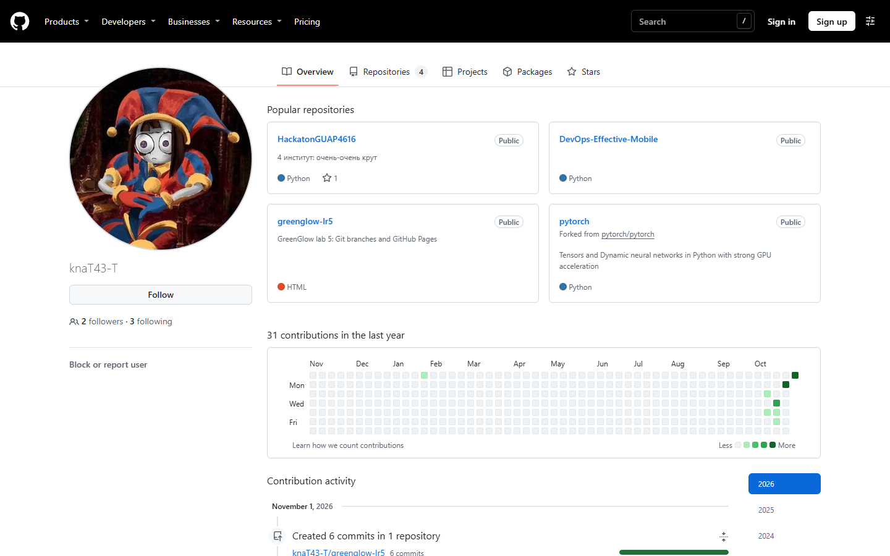

*Рисунок 1 — Профиль GitHub с репозиторием greenglow-lr5 и форком pytorch.*

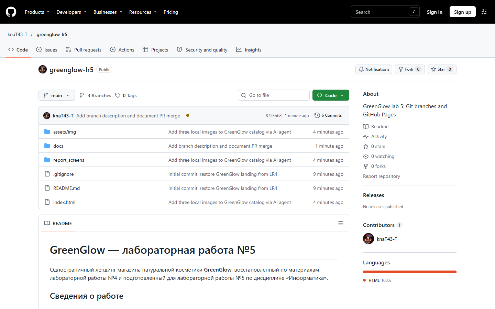

*Рисунок 2 — Главная страница публичного репозитория greenglow-lr5.*

### 5.3. Форк внешнего репозитория

В качестве внешнего проекта выбран крупный открытый репозиторий **pytorch/pytorch**. Форк создан без локального клонирования:

```bash
gh repo fork pytorch/pytorch --clone=false
```

**URL форка:** https://github.com/knaT43-T/pytorch

Проверка через API:

```bash
gh api repos/knaT43-T/pytorch `
  --jq '{fork,parent:.parent.full_name,source:.source.full_name}'
```

```json
{"fork":true,"parent":"pytorch/pytorch","source":"pytorch/pytorch"}
```

Форк является полноценной копией внешнего репозитория в аккаунте `knaT43-T` и сохраняет связь с исходным проектом. В отличие от клонирования, форк создаёт удалённый репозиторий, который можно дорабатывать и предлагать изменения через Pull Request.

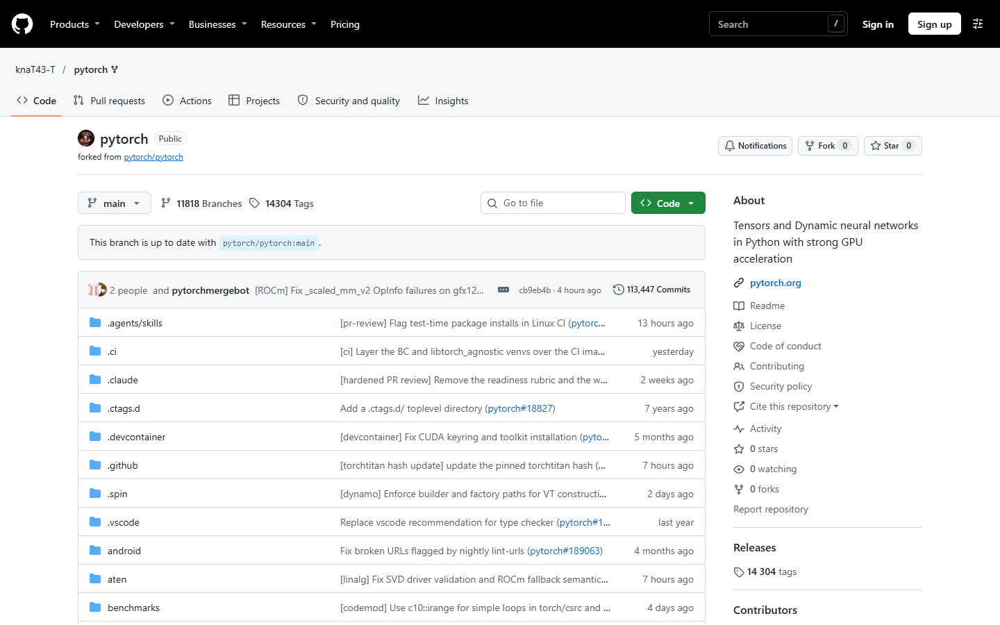

*Рисунок 3 — Форк внешнего репозитория pytorch/pytorch.*

### 5.4. Ветвь `feature/add-images` и работа агента

От актуальной ветви `main` создана ветвь:

```bash
git checkout -b feature/add-images
```

Агенту был передан промт: найти блок каталога, заменить текстовые заглушки в первых трёх карточках на локальные изображения `assets/img/photo1.jpg`, `photo2.jpg`, `photo3.jpg`, добавить осмысленные `alt`, `width`, `height`, `loading="lazy"`, `decoding="async"`, добавить CSS с `object-fit: cover`, не использовать внешние ссылки и не ломать адаптивную сетку. Полная версия промта — в `docs/agent_prompt.md`.

Изображения созданы агентом в рабочей папке программно, с помощью Python и Pillow:

- `photo1.jpg` — увлажняющий крем с алоэ, 1200 × 900, JPEG;
- `photo2.jpg` — сыворотка с витамином C, 1200 × 900, JPEG;
- `photo3.jpg` — гидрофильное масло, 1200 × 900, JPEG.

Причина программной генерации: встроенный сервис генерации изображений вернул ошибку `Access denied by security policy`. Резервный вариант позволил получить собственные изображения в едином стиле, без внешних зависимостей и лицензионных ограничений. Скрипт сохранён в `docs/tools/make_product_images.py`.

В `index.html` добавлены три изображения:

```html
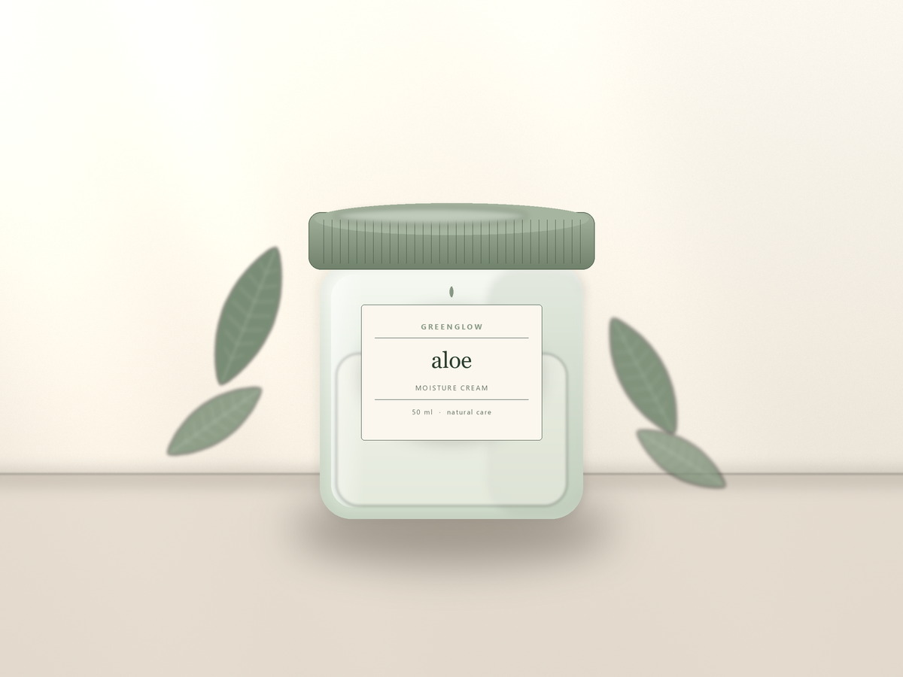


```

CSS:

```css
.product-img img {
  position: absolute;
  inset: 0;
  width: 100%;
  height: 100%;
  object-fit: cover;
  display: block;
}
```

Дополнительно убраны два декоративных «плавающих» блока в hero-визуале, которые перекрывали подпись товара и элемент `01 / 06` на карточке. Это улучшило читаемость первого экрана; сами ценности бренда остались в статистике и блоке преимуществ.

Изменения закоммичены:

```bash
git add .
git commit -m "Add three local images to GreenGlow catalog via AI agent"
```

Хеш коммита — `a5a936e`. Второй коммит `1301295` добавил diff и обновлённые заметки агента. Ветвь отправлена на GitHub:

```bash
git push -u origin feature/add-images
```

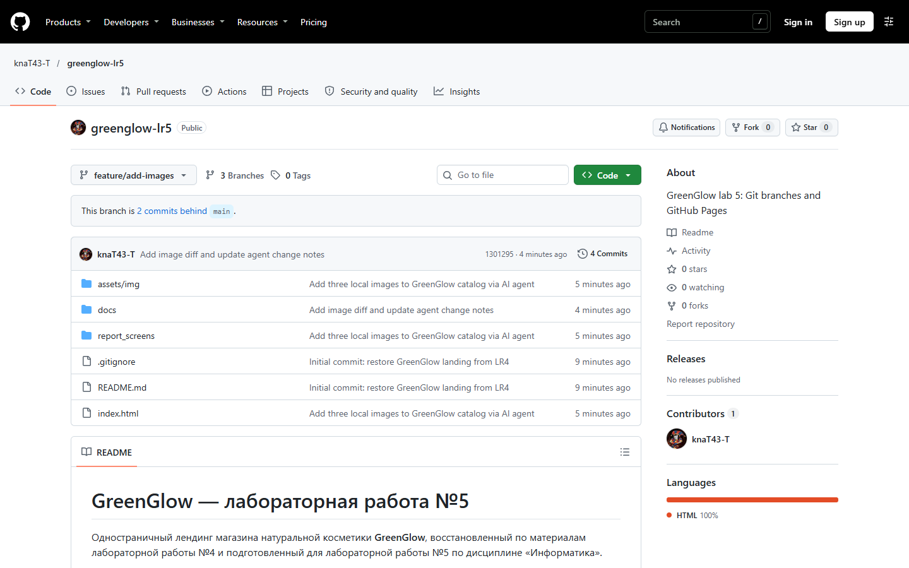

*Рисунок 4 — Ветка feature/add-images с коммитами добавления изображений.*

### 5.5. Слияние ветви с `main`

Создан Pull Request №1:

- URL: https://github.com/knaT43-T/greenglow-lr5/pull/1
- заголовок: «Add three images to GreenGlow catalog»;
- база: `main`;
- источник: `feature/add-images`;
- изменено 16 файлов, +794 / −72.

Слияние выполнено через GitHub CLI:

```bash
gh pr merge 1 --merge
```

Результат:

```json
{
  "base": "main",
  "head": "feature/add-images",
  "mergeCommit": "9c7655f15bff6e93904247135b76621c93807387",
  "mergedAt": "2026-11-01T11:57:47Z",
  "number": 1,
  "state": "MERGED",
  "title": "Add three images to GreenGlow catalog"
}
```

Ветвь `feature/add-images` **не удалена** после слияния: это позволяет показать её в отчёте и при необходимости вернуться к изменениям. Локальная `main` обновлена командой `git pull origin main` (fast-forward до `9c7655f`).

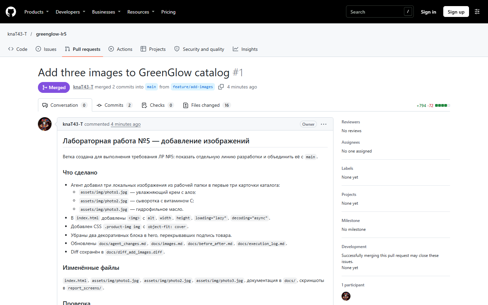

*Рисунок 5 — Pull Request №1 со статусом Merged.*

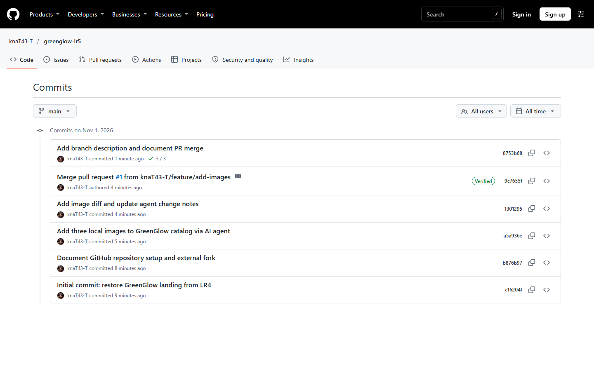

*Рисунок 6 — История коммитов основной ветки.*

### 5.6. Третья ветвь `fix/remove-emoji`

Для демонстрации отдельной линии разработки создана ветвь:

```bash
git checkout -b fix/remove-emoji
```

В ней выполнены изменения дизайна:

- эмодзи `🌿` в логотипе заменён на CSS-знак листа `.leaf-mark` (в шапке и подвале);
- эмодзи `🌿`, `♻️`, `🐇` в блоке преимуществ заменены на строгие текстовые маркеры `100%`, `ЭКО`, `CF`;
- декоративный символ `✿` в строке ценностей заменён на нейтральную точку;
- добавлены `docs/branch_notes.txt` и `docs/branch_description.md`.

Коммит:

```bash
git add index.html docs/branch_notes.txt docs/branch_description.md report_screens/fix_remove_emoji_*.png
git commit -m "Remove emoji noise and improve minimal visual style"
git push -u origin fix/remove-emoji
```

Хеш коммита — `d196168`. Ветвь **не слита** с `main`: она остаётся альтернативным вариантом оформления. Это соответствует требованию иметь не менее трёх ветвей и показывает, что экспериментальная ветвь не обязана попадать в основную.

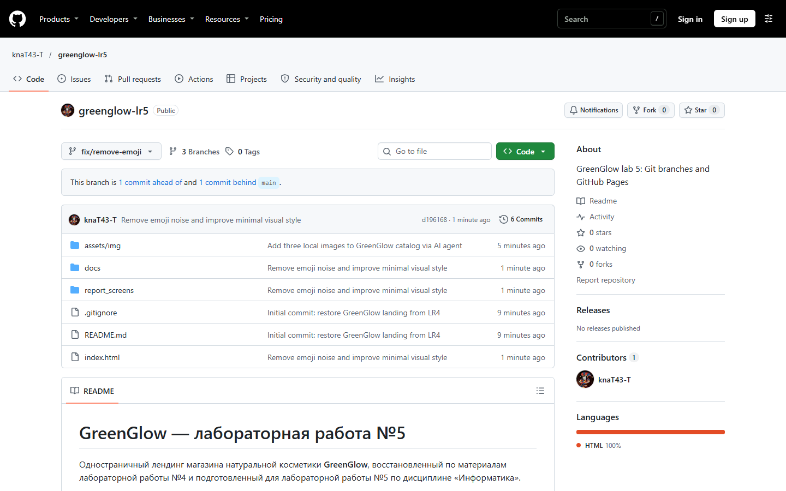

*Рисунок 7 — Ветка fix/remove-emoji с альтернативным оформлением.*

### 5.7. Публикация через GitHub Pages

Публикация включена через GitHub API:

```powershell
'{"source":{"branch":"main","path":"/"}}' | Out-File -Encoding ascii source_materials\pages.json
gh api -X POST repos/knaT43-T/greenglow-lr5/pages --input source_materials/pages.json
```

Параметры публикации:

| Параметр | Значение |
|---|---|
| Ветка | `main` |
| Папка | `/` (корень) |
| Тип сборки | `legacy` |
| HTTPS | включён |
| Статус | `built` |
| Коммит сборки | `8753b68` |

**Рабочий адрес сайта:** https://knat43-t.github.io/greenglow-lr5/

Первый запрос после включения вернул HTTP 404, потому что сборка ещё не завершилась. После завершения сборки сайт начал отдавать HTTP 200, размер страницы — 51 896 байт. Заголовок страницы: «GreenGlow — красота, созданная природой».

Сборка прошла в workflow `pages-build-deployment`:

| Job | Статус | Время |
|---|---|---|
| `build` | успешно | 23 с |
| `report-build-status` | успешно | 3 с |
| `deploy` | успешно | 21 с |

Общее время сборки — 56 секунд. Адрес деплоя, указанный в run: `https://knat43-t.github.io/greenglow-lr5/`.

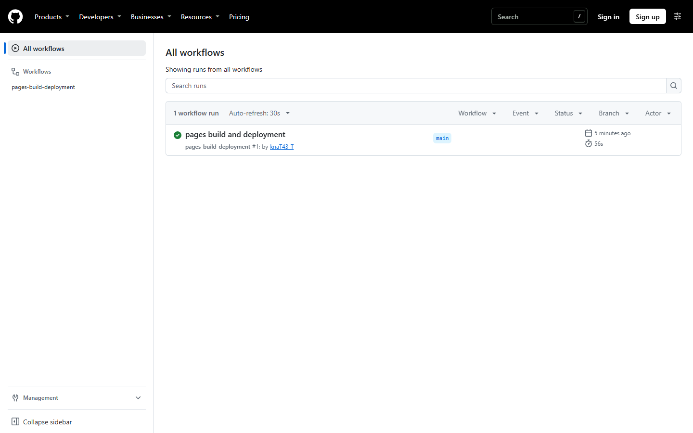

*Рисунок 8 — Успешная сборка GitHub Pages в Actions.*

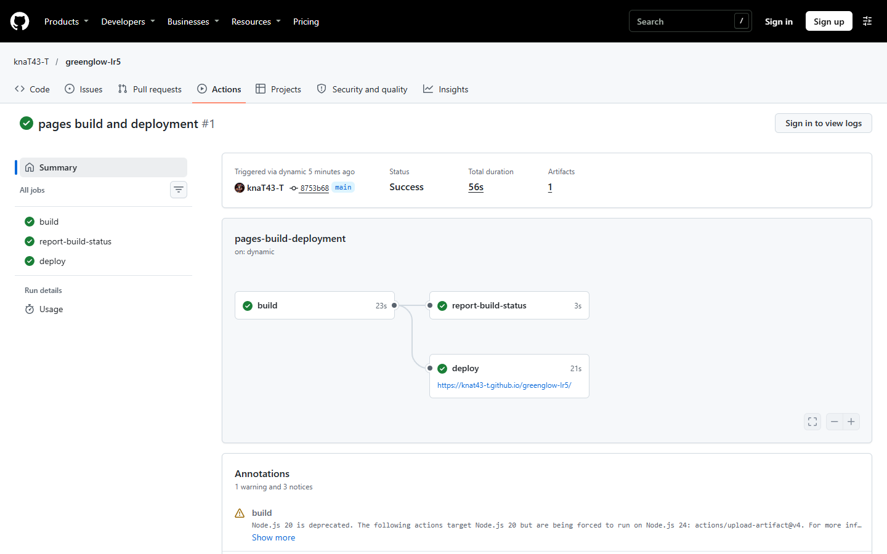

*Рисунок 9 — Детали сборки и адрес опубликованного сайта.*

## 6. Результаты

### 6.1. Ветви проекта

| Ветвь | Назначение | Статус |
|---|---|---|
| `main` | основная ветвь с актуальной версией сайта | основная |
| `feature/add-images` | добавление трёх локальных изображений в каталог | слита в `main` через PR #1, сохранена |
| `fix/remove-emoji` | альтернативное оформление без эмодзи | не слита, оставлена для сравнения |

Все три ветви опубликованы на GitHub. Список ветвей доступен по адресу: https://github.com/knaT43-T/greenglow-lr5/branches

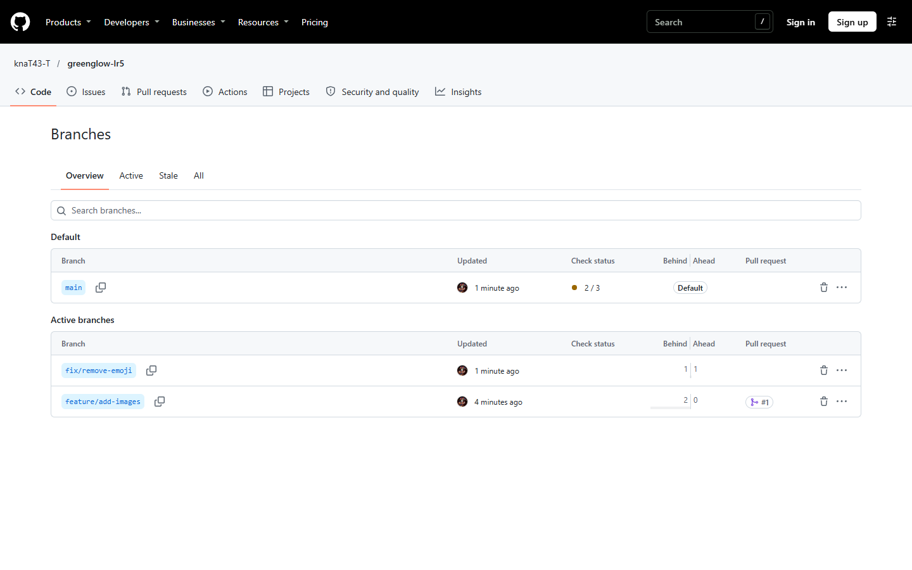

*Рисунок 10 — Список ветвей проекта на GitHub.*

### 6.2. Изображения на сайте

После слияния в `main` находятся три локальных изображения:

| Файл | Размер | Формат | Где используется |
|---|---|---|---|
| `assets/img/photo1.jpg` | 1200 × 900 | JPEG | карточка «Увлажняющий крем с алоэ» |
| `assets/img/photo2.jpg` | 1200 × 900 | JPEG | карточка «Сыворотка с витамином С» |
| `assets/img/photo3.jpg` | 1200 × 900 | JPEG | карточка «Гидрофильное масло» |

В HTML ровно три локальных `` с относительными путями. Внешних ссылок на изображения нет. При проверке в браузере все три изображения загружаются, `naturalWidth = 1200`.

**До изменений** в первых трёх карточках каталога были текстовые заглушки на градиентном фоне. **После изменений** там отображаются изображения продуктов; бейджи «Хит» и «Новинка» остаются поверх изображений.

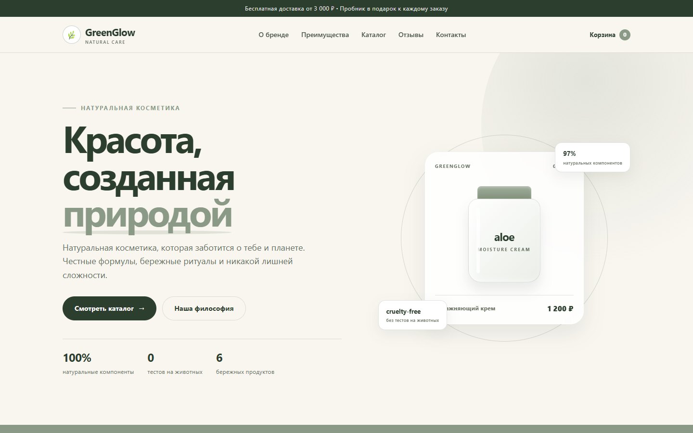

*Рисунок 11 — Сайт до добавления изображений.*

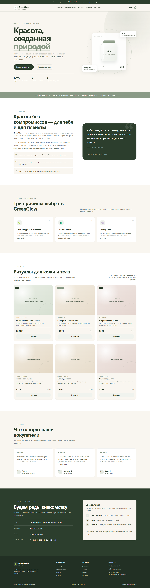

*Рисунок 12 — Полная страница сайта до изменений.*


*Рисунок 13 — Сайт после добавления изображений.*

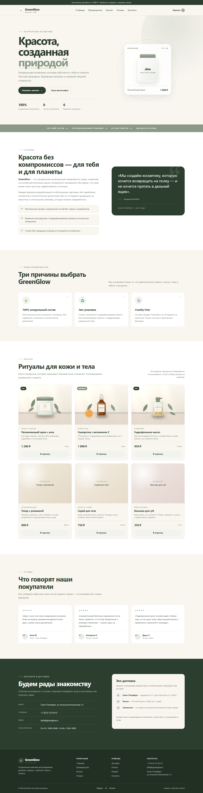

*Рисунок 14 — Полная страница сайта после изменений.*

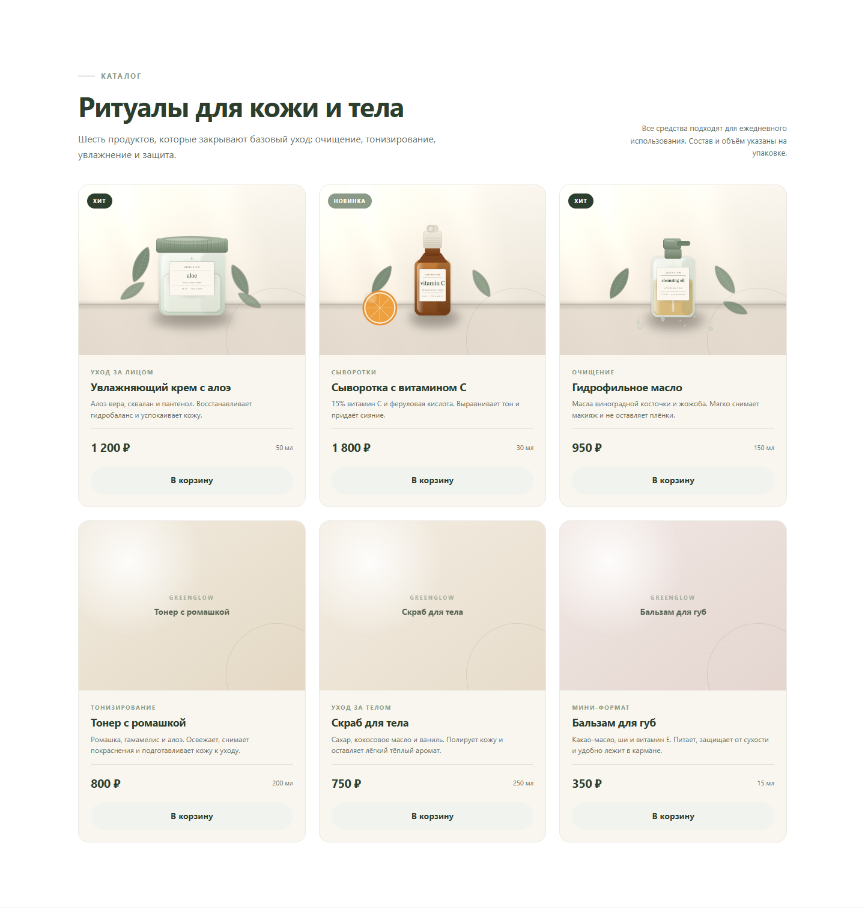

*Рисунок 15 — Блок каталога с тремя локальными изображениями.*

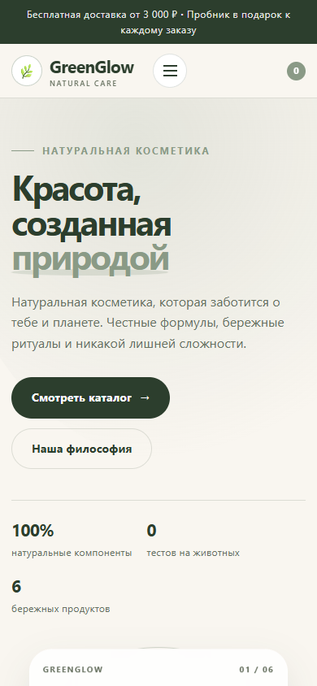

*Рисунок 16 — Мобильная версия сайта после изменений.*

### 6.3. Альтернативная ветвь

Ветвь `fix/remove-emoji` показывает альтернативный эко-минималистичный вариант: вместо эмодзи используются CSS-знак листа и текстовые маркеры. Ветвь не влияет на основную версию сайта и может быть использована для сравнения дизайнерских решений.

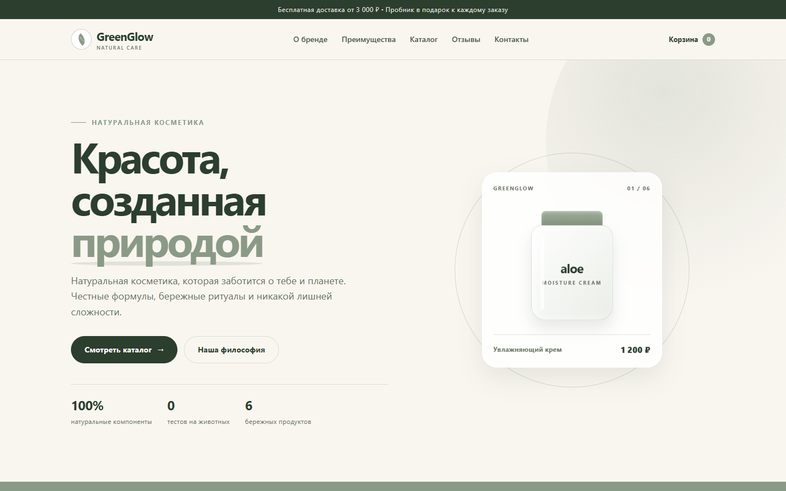

*Рисунок 17 — Альтернативный вариант без эмодзи.*

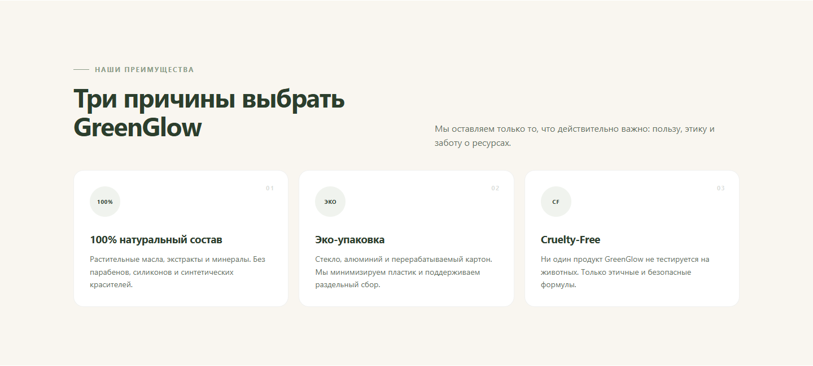

*Рисунок 18 — Блок преимуществ с текстовыми маркерами.*

### 6.4. Опубликованный сайт

Сайт опубликован из ветви `main`, папка — корень репозитория. Публикация работает по HTTPS, страница отдаёт HTTP 200. На десктопе и на мобильном устройстве сайт отображается корректно; при ширине 390 px горизонтальная прокрутка отсутствует (`scrollWidth = clientWidth = 390`).

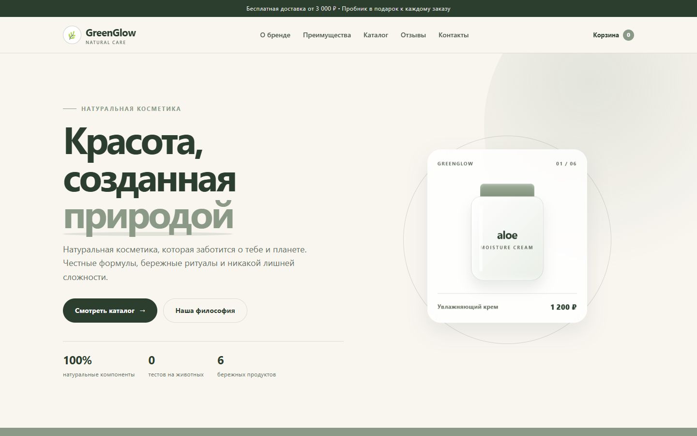

*Рисунок 19 — Опубликованный сайт на GitHub Pages.*

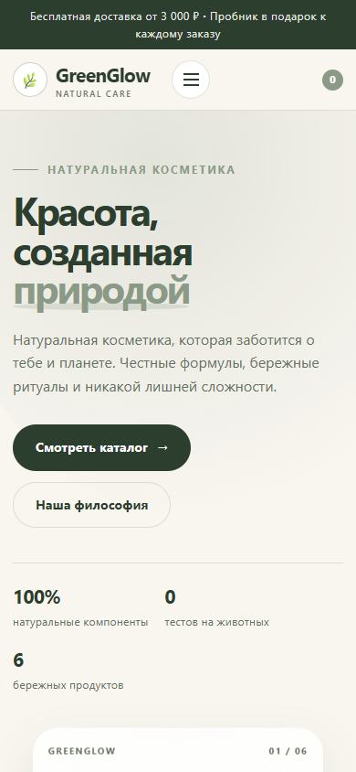

*Рисунок 20 — Опубликованный сайт в мобильной версии.*

## 7. Выводы

В ходе лабораторной работы были решены все поставленные задачи:

1. Восстановлен сайт GreenGlow из лабораторной работы №4: одностраничный адаптивный лендинг из восьми блоков, без JavaScript и внешних зависимостей.
2. Создан публичный репозиторий на GitHub и связан с локальной рабочей папкой.
3. Созданы три ветви: `main`, `feature/add-images`, `fix/remove-emoji`. Ветвь `feature/add-images` слита с `main` через Pull Request №1; ветвь `fix/remove-emoji` оставлена как альтернативная.
4. Создан форк внешнего репозитория `pytorch/pytorch`.
5. Агент добавил на сайт три локальных изображения из рабочей папки, изменил HTML и CSS, подготовил документацию и diff.
6. Сайт опубликован через GitHub Pages и доступен по адресу https://knat43-t.github.io/greenglow-lr5/.
7. Подготовлены текст отчёта, скриншоты, чек-лист и итоговая проверка.

Система управления версиями Git позволяет вести параллельную разработку, сохранять историю изменений, безопасно экспериментировать в отдельных ветвях и объединять только проверенные изменения. GitHub дополняет Git удалённым хранением, совместной работой, Pull Request, форками и публикацией статических сайтов через GitHub Pages.

## 8. Список использованных источников

1. Методические указания к лабораторной работе №5 по дисциплине «Информатика». — 42 с.
2. Отчёт по лабораторной работе №4 «Разработка одностраничного сайта GreenGlow». — 21 с.
3. Git Documentation. — URL: https://git-scm.com/doc (дата обращения: 01.11.2026).
4. GitHub Docs. About forks. — URL: https://docs.github.com/en/pull-requests/collaborating-with-pull-requests/working-with-forks (дата обращения: 01.11.2026).
5. GitHub Docs. GitHub Pages. — URL: https://docs.github.com/en/pages (дата обращения: 01.11.2026).
6. GitHub CLI Manual. — URL: https://cli.github.com/manual/ (дата обращения: 01.11.2026).

## Приложение А. Основные команды

```bash
# Инициализация и первый коммит
git init
git branch -M main
git add .
git commit -m "Initial commit: restore GreenGlow landing from LR4"

# Публикация репозитория
gh repo create greenglow-lr5 --public --source=. --remote=origin --push

# Форк внешнего проекта
gh repo fork pytorch/pytorch --clone=false

# Ветвь с изображениями
git checkout -b feature/add-images
git add .
git commit -m "Add three local images to GreenGlow catalog via AI agent"
git push -u origin feature/add-images

# Pull Request и слияние
gh pr create --base main --head feature/add-images `
  --title "Add three images to GreenGlow catalog" `
  --body-file docs/pr_body.md
gh pr merge 1 --merge

# Альтернативная ветвь
git checkout -b fix/remove-emoji
git add index.html docs/branch_notes.txt docs/branch_description.md
git commit -m "Remove emoji noise and improve minimal visual style"
git push -u origin fix/remove-emoji

# GitHub Pages
'{"source":{"branch":"main","path":"/"}}' | Out-File -Encoding ascii source_materials\pages.json
gh api -X POST repos/knaT43-T/greenglow-lr5/pages --input source_materials/pages.json
```

## Приложение Б. Ссылки

| Объект | Ссылка |
|---|---|
| Репозиторий | https://github.com/knaT43-T/greenglow-lr5 |
| Ветви | https://github.com/knaT43-T/greenglow-lr5/branches |
| Pull Request №1 | https://github.com/knaT43-T/greenglow-lr5/pull/1 |
| Форк | https://github.com/knaT43-T/pytorch |
| GitHub Pages | https://knat43-t.github.io/greenglow-lr5/ |
| Сборка Pages | https://github.com/knaT43-T/greenglow-lr5/actions/runs/41304416467 |
| Профиль GitHub | https://github.com/knaT43-T |
